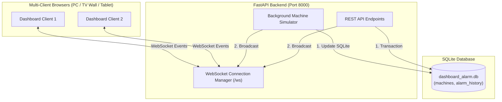

# ISUZU ENGINE – Dashboard Alarm BD (Phase 1 Demo)


ระบบแดชบอร์ดแจ้งเตือนเครื่องจักรขัดข้องและติดตามเวลาหยุดทำงานแบบเรียลไทม์ (**Machine Breakdown & Real-Time Downtime Monitoring System**) สำหรับแผนกซ่อมบำรุง (PM Shop) ออกแบบในธีม **Isuzu Engine Manufacturing (Thailand)** โดยใช้ **React + TypeScript + FastAPI + WebSocket + SQLite**

> **หมายเหตุสำคัญ (DEMO / SIMULATED DATA):**  
> โปรเจกต์นี้เป็น **เวอร์ชันสาธิต (Demo Version)** ตามข้อเสนอโครงการ *"Dashboard Alarm BD – Phase 1"* โดยใช้ฐานข้อมูล **SQLite** ร่วมกับระบบจำลองสถานะเครื่องจักรอัตโนมัติ (Background Simulator) **ไม่ได้เชื่อมต่อกับระบบ IBM Maximo จริง** ข้อมูลเครื่องจักรและใบแจ้งซ่อม (SR) ทั้งหมดเป็นข้อมูลจำลองเพื่อสาธิตสถาปัตยกรรมและการทำงานแบบเรียลไทม์

---

## ความสามารถหลักของระบบ (Key Features)

1. **Real-Time WebSocket Streaming**
   - เชื่อมต่อแบบ Persistent WebSocket (`/ws` และ `/api/ws`) ระหว่าง Frontend และ FastAPI Backend
   - กระจายสถานะเครื่องจักรทันที (**Broadcast**) ไปยังทุกหน้าจอที่เปิดพร้อมกันโดยไม่ต้องรีเฟรชหน้าเว็บ
   - รองรับการเชื่อมต่อใหม่อัตโนมัติ (**Auto-Reconnect**) พร้อมไฟแสดงสถานะการเชื่อมต่อ:
     - 🟢 **Connected**: เชื่อมต่อเรียลไทม์สำเร็จ
     - 🟡 **Reconnecting**: กำลังพยายามเชื่อมต่อใหม่
     - 🔴 **Disconnected**: ขาดการเชื่อมต่อ

2. **การติดตามสถานะเครื่องจักร 10 เครื่อง (4 พื้นที่)**
   - ครอบคลุมเครื่องจักร `MC-001` ถึง `MC-010` ใน 4 โซน: **PM1 Shop**, **PM1 Overhaul**, **PM2 Shop**, และ **PM2 Overhaul**
   - แยก 3 สถานะหลักอย่างชัดเจน:
     - 🟢 **NORMAL** – เครื่องจักรทำงานปกติ ไม่มี Downtime
     - 🔴 **BREAKDOWN** – เครื่องจักรขัดข้อง แสดงหมายเลข SR, รายละเอียดปัญหา และแถบแจ้งเตือนสีแดง
     - 🟡 **STOPPED** – เครื่องจักรหยุดทำงาน แสดงเหตุผลการหยุดและระยะเวลาหยุดสะสม

3. **การนับเวลา Downtime สดทุก 1 วินาที (Live 1-Second Ticker)**
   - คำนวณระยะเวลาจาก timestamp จริงที่จัดเก็บใน SQLite (`breakdown_start_time` / `stopped_start_time`)
   - อัปเดตตัวเลขแบบเรียลไทม์ทุกวินาทีบนหน้าจอ และหยุดนับทันทีเมื่อเครื่องจักรกลับสู่สถานะ `NORMAL`

4. **กราฟวิเคราะห์และสรุปผล (Real-Time Analytics with Recharts)**
   - **Summary Cards**: สรุปจำนวน Total / Normal / Breakdown / Stopped แบบไดนามิก
   - **Status Distribution**: สัดส่วนสถานะเครื่องจักรทั้งหมด
   - **Status by Location**: สถานะแยกตามพื้นที่ PM1 / PM2
   - **Downtime Overview**: เปรียบเทียบเวลาหยุดทำงานของเครื่องจักรที่กำลัง `BREAKDOWN` และ `STOPPED` แบบเรียลไทม์

5. **ประวัติการแจ้งเตือนและตัวกรองวันที่ (Alarm History & Audit Trail)**
   - บันทึกทุกเหตุการณ์เปลี่ยนสถานะลงตาราง `alarm_history` ใน SQLite
   - ค้นหาตามเครื่องจักร, สถานะ, พื้นที่ และเลือกช่วงวันที่ (พร้อมปุ่มลัด: **วันนี้, เมื่อวาน, 7 วันล่าสุด, 30 วันล่าสุด, ทั้งหมด**)
   - รองรับการส่งออกข้อมูลเป็นไฟล์ **CSV**

6. **แผงควบคุมการจำลอง (Simulation Controls)**
   - จำลองสถานะเครื่องจักรต่อเนื่องอัตโนมัติใน Background (ตั้งค่าช่วงเวลาได้ เริ่มต้นทุก 5 วินาที)
   - เปิด/ปิดการจำลอง และทดลองเปลี่ยนสถานะเครื่องจักรแต่ละเครื่องได้ทันทีจากหน้าจัดการเครื่องจักร

---

## เทคโนโลยีที่ใช้ (Tech Stack)

- **Frontend**: React 18, TypeScript, Vite, Tailwind CSS, Recharts, Lucide React
- **Backend**: Python, FastAPI, Uvicorn, WebSockets, SQLAlchemy ORM, Pydantic
- **Database**: SQLite (`dashboard_alarm.db` สร้างอัตโนมัติเมื่อรัน Backend)

---

## สถาปัตยกรรมระบบ (Architecture)



---

## โครงสร้างโปรเจกต์ (Project Structure)

```text
Demo_Project/
├── backend/                     # FastAPI Backend, SQLAlchemy models, CRUD, Simulator, WebSocket
├── frontend/                    # React + Vite + TypeScript + Tailwind Dashboard
│   ├── public/                  # Isuzu logos & web assets
│   └── src/                     # Components, pages, hooks, API & WebSocket services
├── run_backend.py               # Entry point สำหรับรัน FastAPI server
├── start_all.bat                # สคริปต์เปิด Backend + Frontend พร้อมกันบน Windows
├── start_backend.bat            # สคริปต์เปิด Backend อย่างเดียว
├── start_frontend.bat           # สคริปต์เปิด Frontend อย่างเดียว
├── test_api.py                  # สคริปต์ทดสอบ REST API
├── test_websocket_realtime.py   # สคริปต์ทดสอบ WebSocket Real-Time
├── generate_presentation.py     # สคริปต์สร้างไฟล์ PowerPoint นำเสนอโครงการ
└── README.md
```

---

## วิธีการติดตั้งและรันใช้งาน (Getting Started)

### 1. ติดตั้ง Dependencies

**Backend (Python 3.10+):**
```powershell
pip install -r backend/requirements.txt
```

**Frontend (Node.js 18+):**
```powershell
cd frontend
npm install
cd ..
```

### 2. รันระบบ

**วิธีที่ 1: รันทั้งหมดพร้อมกันบน Windows**
ดับเบิลคลิกไฟล์ `start_all.bat` หรือรันใน Terminal:
```powershell
.\start_all.bat
```

**วิธีที่ 2: รันแยกทีละ Terminal**
```powershell
# Terminal 1: Backend (http://localhost:8000)
python run_backend.py

# Terminal 2: Frontend (http://localhost:5173)
cd frontend
npm run dev
```

เมื่อรันเสร็จแล้ว สามารถเข้าใช้งานได้ที่:
- **Dashboard Frontend**: `http://localhost:5173`
- **Backend API Docs (Swagger)**: `http://localhost:8000/docs`
- **WebSocket Endpoint**: `ws://localhost:8000/ws`

---

## การทดสอบ (Testing)

ทดสอบ REST API และระบบ WebSocket Real-Time ขณะที่ Backend กำลังทำงาน:

```powershell
python test_api.py
python test_websocket_realtime.py
```

---

## เอกสารนำเสนอโครงการ (Presentation)

โปรเจกต์นี้มาพร้อมสคริปต์ `generate_presentation.py` และไฟล์นำเสนอโครงการ `Dashboard_Alarm_BD_Isuzu_Presentation_Redesign.pptx` / `.pdf` สำหรับใช้นำเสนอข้อเสนอโครงการ **Dashboard Alarm BD – Phase 1** (นาย ธนวัฒน์ ประสาทเขตรการ, มหาวิทยาลัยศรีปทุม)
